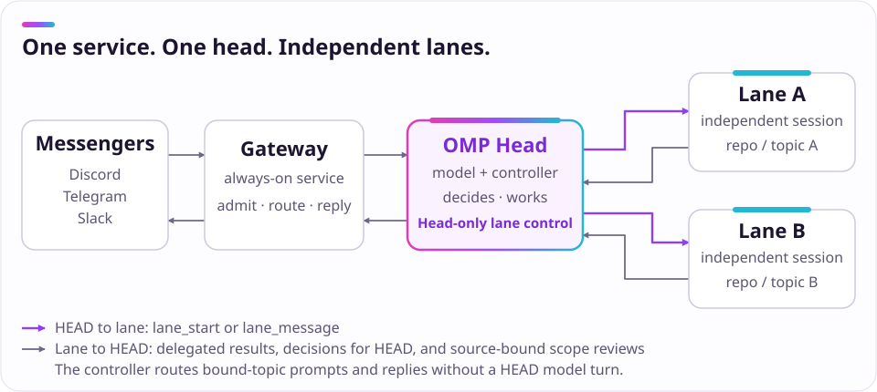

<p align="center">
  
</p>

[English](README.md) · **한국어**

# omp-superagent

**메신저에서 하나의 OMP 헤드와 대화하고, 필요한 작업만 독립적인 저장소·주제 레인으로 나눕니다.**

Discord·Telegram·Slack을 [oh-my-pi](https://github.com/can1357/oh-my-pi)의 세션·인증·도구·native `task`에 연결합니다.
헤드는 직접 작업하거나 독립 레인에 위임하고 결과를 종합합니다. 기존 레인에 연결된 대화에서도 모든 후속 입력은 먼저 헤드로 갑니다.

[설계](DESIGN.md) · [운영](docs/OPERATIONS.md) · [설정 예제](config.example.json)

## 배포 형태

**0.1.0은 Bun 소스 배포판입니다.**
[GitHub Release](https://github.com/dbc-hbin/omp-superagent/releases/tag/v0.1.0)의 소스 tarball을 받아 아래 준비 절차를
따르세요. npm 패키지나 독립 실행 바이너리는 제공하지 않습니다. OMP는 미리 설치되어 있어야
하며 이 프로젝트가 패치하거나 빌드하지 않습니다. 관리형 의존성은 별도로 설치합니다.

## 차별점

- **직접 실행하는 헤드:** 조사·구현을 직접 처리하거나, 분리할 작업의 범위와 인계를 정해 위임합니다.
- **맡긴 목표 안의 자율 실행:** 다음 유용한 일을 선택·우선순위화하고 계획·실행·검증·수정합니다.
  검증한 중간 결과 뒤에도 남은 허가 작업을 단계별 허락 없이 이어가되 새 범위·외부 효과를 임의로 추가하지 않습니다.
- **저장소·주제별 독립 레인:** 별도 OMP Host와 세션으로 작업 디렉터리와 맥락을 나눕니다.
- **레인별 native 모델·프리셋:** 헤드가 native judge의 자문을 받아 선택하며, 다른 레인이나 전역 설정을 바꾸지 않습니다.
- **연결과 세션 수명의 분리:** 지속 실행되는 Gateway가 메신저 연결과 수신·조율 장부를 맡고, OMP 세션이 대화 맥락을 맡습니다.
- **관리 세션만 쓰는 공유 게시판:** 같은 인스턴스에 등록된 헤드·레인이 정보를 공유하며, 명령이나 승인 경로로 쓰지 않습니다.
- **순정 OMP 사용:** 관리형 익스텐션과 공개 API로 기존 세션·도구·승인·인증을 재사용하며 코어 fork를 유지하지 않습니다.

## 구조



[구조도 Mermaid 원본](assets/architecture.mmd)

Gateway는 메신저 연결·수신 장부·헤드 수명을 관리하는 데몬입니다. 작업을 판단하고 레인을 지시하는 주체는 헤드입니다.
레인은 결과를 헤드에 보고하고, 헤드는 원래 대화에 맞춰 답합니다.

## 빠른 시작

Git, **Bun >= 1.4.4**, 미리 설치된 **OMP >= 18.20.2, < 19**, 로컬 Unix socket 지원 환경이 필요합니다.
검증 기준 OMP는 **18.20.2**이며 Windows는 지원하지 않습니다.

### 1. 소스 준비

저장소 루트에서 순서대로 실행합니다.

```sh
omp --version
bun install --frozen-lockfile
```

설치 시 별도로 설치된 OMP를 먼저 확인하고, postinstall이 필수 관리형 `omp-ulw`를 준비합니다.
OMP가 없다면 [공식 설치 안내](https://github.com/can1357/oh-my-pi#installation)에 따라 먼저 설치하세요.
공개 SDK 패키지와 플랫폼 네이티브 의존성은 패키지 레지스트리에서 받으며, Rust 도구·OMP 소스
checkout·코어 패치·네이티브 빌드가 필요하지 않습니다. 의존성 설치에는 네트워크가 필요하지만,
봇을 시작하거나 설치된 OMP를 교체하지는 않습니다.
`command`에는 설치된 OMP 실행 파일과 그 뒤에 네이티브 CLI 옵션을 지정합니다.
Bun 등 런타임으로 OMP 소스를 실행하는 래퍼는 지원하지 않습니다.

CLI 명령어는 **`omp-sa`**이며 프로젝트·패키지 이름은 `omp-superagent`로 유지합니다.
준비한 저장소에서 `bun link`로 등록하고 Bun의 전역 bin 디렉터리를 `PATH`에 포함합니다.

```sh
bun link
omp-sa --help
```

아래의 `bun --no-env-file src/cli.ts`는 등록 없이 같은 CLI를 실행하는 소스 호출 방식입니다.
`omp-sa` 실행 파일도 `.env` 자동 로딩을 끕니다.

### 2. 설정과 자격 증명

[플랫폼 앱·권한](docs/OPERATIONS.md#2-플랫폼별-앱과-접근-범위)을 준비한 뒤 터미널에서 실행합니다.

```sh
bash scripts/setup.sh
```

셋업은 `config.local.json`을 만들고 숨김 입력으로 받은 토큰을 소유자 전용
`config.local.json.env`(`0600`)에 저장합니다. 파일은 암호화 저장소가 아닌 평문이며,
비어 있지 않은 셸 자격 증명이 우선합니다. 모델 제공자 인증은 기존 OMP 방식으로 설정합니다.

봇·모델 세션은 시작하지 않습니다. 최종 저장 확인에는 Discord/Telegram 봇 프로필 사진을
마스코트로 바꾸는 작업도 포함됩니다. 권장하는 Mnemopi 기억 backend 활성화는 별도의 명시적
`yes`와 최종 저장 확인이 있어야 하며 OMP 전역 기억 backend를 변경합니다.
누락된 native judge 역할은 설정을 권장하지만 모델을 자동 선택하거나 호출하지 않습니다.

메모리 동작, 다른 설정 경로, 수동 설정과 저장 효과는
[설정 가이드](docs/OPERATIONS.md#3-설정)를 참고하세요.

### 3. 진단 후 명시적으로 시작

```sh
bun --no-env-file src/cli.ts doctor --config config.local.json
```

소스 준비와 `doctor`는 메신저에 로그인하지 않습니다. `doctor`로 로컬 설정과 CLI·자격 증명 환경을 진단한 뒤 시작합니다.

```sh
bun --no-env-file src/cli.ts start --config config.local.json
```

최초 시작 때 누락된 native `high`/`middle`/`low` 프리셋은 같은 헤드의 전용 초기 설정 턴에서
생성·재조회하고, 그 뒤 일반 작업을 실행합니다. 기존 프리셋은 보존합니다. `status`는 프리셋
초기화와 transport 준비를 구분하며 실패·미완료를 준비 완료로 표시하지 않습니다.
`setup`과 `doctor`는 계속 봇·모델을 실행하지 않습니다.

`start`는 설정에 남긴 **모든 플랫폼**을 활성화하고, detached Gateway와 헤드를 시작합니다.
이 패치 없는 배포판은 관리형 RPC Host에 native TUI/herdr로 접속하는 기능을 제공하지 않습니다.
관리 세션은 메신저 명령과 `omp-sa status`로 확인하고 제어합니다.

상태 조회·종료·macOS 로그인 후 자동 시작·복구는 [운영 가이드](docs/OPERATIONS.md)를
참고하세요. 로그인 자동 시작은 한 번 실행하는 방식이며 crash 자동 재시작은 아닙니다.
Linux 서비스 설치는 제공하지 않습니다.

## 사용 방법

- 일반 메시지로 요청하세요. 질문은 바로 답하고, 작업 지시는 별도 주제에서 짧은 착수 보고와
  의미 있는 진척·결과를 전달합니다.
- 같은 주제의 후속 입력은 헤드를 통해 실행 중인 작업을 조정합니다. 저장소·주제별 레인 맥락은
  독립적입니다. 음성 첨부 메타데이터 보존이 자동 전사를 뜻하지는 않습니다.
- `/help`와 `/status`로 명령·상태를 확인합니다. `/model`·`/effort`는 유휴 헤드 세션만
  바꾸며 기존 레인·전역 기본값은 유지합니다. 전역 프리셋 저장은 명시적 `--global`이 필요합니다.
  Slack 일반 메시지 명령은 `!`를 씁니다.
- `/stop`은 연결 레인을 일시정지하고 `/resume`은 재개를 허가합니다. 승인·취소·도구 제외와
  불확실한 효과에 대한 보류는 유지합니다. 진척 보고·복구가 작업 완료의 검증이나 외부 효과의
  취소를 뜻하지 않으며, 저장된 goal은 crash replay나 로드되지 않은 상태의 실행을 보장하지 않습니다.

명령 등록, 재시작·복구 의미와 플랫폼 차이는
[명령과 일상 사용](docs/OPERATIONS.md#4-명령과-일상-사용)을 참고하세요.
저장소를 편집했다고 현재 운영 서비스에 반영되는 것은 아닙니다.

## ULW

공식 [omp-ulw](https://github.com/dbc-hbin/omp-ulw)는 필수 관리형 통합입니다.
사용자의 명시적 요청이나 허가된 작업에 구체적으로 도움이 된다는 헤드의 판단으로 workflow를
선택합니다. 일반 작업은 직접 세션·native task·일반 레인으로 처리할 수 있습니다.

업데이트는 새 Host에 적용하며 실행 중인 헤드·레인의 버전은 유지합니다.
[관리형 통합 운영](docs/OPERATIONS.md#필수-관리형-omp-ulw-설치와-갱신)에서 갱신·활성화 동작을 확인하세요.

## 개발

설치를 마친 뒤 실행합니다.

```sh
bun run check
bun test test
bun run test:ci
```

`check`는 타입 검사입니다. 기본 `bun test test`는 opt-in native/PTY 시나리오를 제외합니다.
`scripts/ci.ts`로 구성한 `test:ci`는 모든 로컬 native/PTY 시나리오와 타입 검사를 실행하며,
실제 계정·모델 제공자 호출 대신 오프라인 fixture를 사용합니다. Python 3도 필요하며
launchd 시나리오는 macOS에서만 실행합니다.
이 검사가 운영 환경이나 실제 계정에서의 준비 완료를 증명하지는 않습니다.

`bun run release`는 커밋된 소스 압축 파일과 SHA256 체크섬을 로컬 `dist`에 만듭니다.
게시하지는 않으며, 태그로 실행되는 GitHub Actions가 CI 이후 GitHub Release를 게시합니다.

## 문서와 출처

- [운영 가이드](docs/OPERATIONS.md): 설치·설정·복구 절차와 검증 근거.
- [설계](DESIGN.md): Gateway·헤드·레인과 공유 게시판의 계약.

[oh-my-pi](https://github.com/can1357/oh-my-pi)를 기반으로 하며, workflow에는 [omp-ulw](https://github.com/dbc-hbin/omp-ulw)를 사용합니다.

## License

프로젝트 코드는 [MIT 라이선스](LICENSE)를 따릅니다. 서드파티 구성 요소에는 별도 조건이
적용됩니다. [THIRD_PARTY_NOTICES.md](THIRD_PARTY_NOTICES.md)를 참고하세요.
